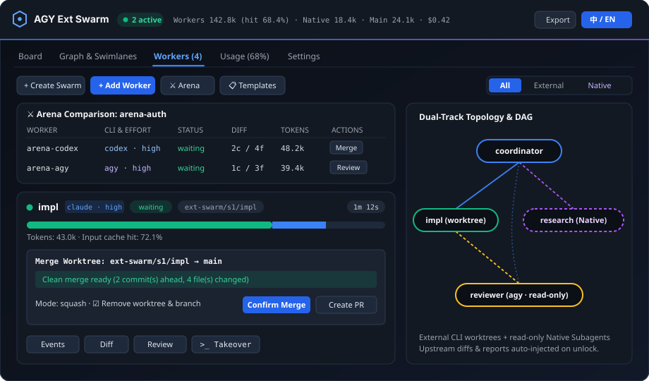

# AGY Ext Swarm — External Multi-CLI Agent Swarm Plugin for Antigravity

> **[中文文档](./README.zh-CN.md)** | English

[](https://www.npmjs.com/package/agy-ext-swarm)
[](https://github.com/ycuwq/agy-ext-swarm/actions/workflows/ci.yml)
[](./LICENSE)
[](https://nodejs.org/)

[Quick Start](#quick-start) · [Key Capabilities](#key-capabilities) · [CLI Providers](#supported-cli-providers) · [Configuration](#configuration) · [MCP Tools](#mcp-tools-44-total-18-model--26-app-only) · [Development](#development--packaging)

An open-source Antigravity (AGY) plugin where Antigravity acts as the **Coordinator** (architect, task splitter, diff reviewer, and merger) to orchestrate external headless coding CLI workers across **`dsh` (DeepSeek Harness)**, **Claude Code (`claude`)**, **OpenAI Codex (`codex`)**, **Gemini CLI (`gemini`)**, **Antigravity CLI (`agy`)**, or **any custom CLI command** in isolated `git worktree` branches over a shared message board.



## Quick Start

### Recommended: Antigravity Desktop (`npx`, Cross-Platform)

Requires only **Node.js >= 20** (no `git`, `pnpm`, or `agy` CLI required). Copies zero-dependency runtime bundles into `~/.gemini/config/plugins/agy-ext-swarm` while preserving `.data/` across upgrades:

```bash
npx -y agy-ext-swarm install
```

Useful management commands:

```bash
npx -y agy-ext-swarm status               # Inspect install path, version, and bundle health
npx -y agy-ext-swarm install --workspace  # Install into ./.agents/plugins for repo/team sharing
npx -y agy-ext-swarm uninstall            # Remove the global plugin
```

### Alternative: `agy` CLI Direct Install

```bash
agy plugin install https://github.com/ycuwq/agy-ext-swarm
```

<details>
<summary>More Install Options (curl / PowerShell / Offline Archives / From Source)</summary>

- **macOS / Linux (GitHub Release one-liner)**:
  ```bash
  curl -fsSL https://raw.githubusercontent.com/ycuwq/agy-ext-swarm/main/scripts/install.sh | bash
  ```
- **Windows PowerShell (GitHub Release one-liner)**:
  ```powershell
  irm https://raw.githubusercontent.com/ycuwq/agy-ext-swarm/main/scripts/install.ps1 | iex
  ```
- **Offline Archive**: Download `agy-ext-swarm.tar.gz` or `agy-ext-swarm.zip` from [GitHub Releases](https://github.com/ycuwq/agy-ext-swarm/releases) and extract the `agy-ext-swarm/` directory into `~/.gemini/config/plugins/` (or `.agents/plugins/`). No `pnpm install` step is needed.
- **From Source (Contributors)**:
  ```bash
  git clone https://github.com/ycuwq/agy-ext-swarm.git
  cd agy-ext-swarm
  node scripts/install.mjs   # Symlink/junction from checkout (--copy for copy mode, --build to rebuild)
  ```
  Manual build:
  ```bash
  cd agy-ext-swarm/server && pnpm install && pnpm build
  ```

</details>

### 3-Step First Run

1. Enable **AGY Ext Swarm** in Antigravity Desktop (**Skills & Customizations**; toggle off/on or restart after upgrading).
2. Open the board (or ask Antigravity to check `ext_swarm_providers`): the **Onboarding Wizard** automatically scans installed CLIs, discovers models, and lets you configure defaults and optional Writer/Reader pools in one step.
3. Ask Antigravity to parallelize multi-module coding, batch refactors, codebase recon, or cross-review—Antigravity dispatches worktree workers, verifies diffs, and lets you merge or open a GitHub PR cleanly.

**Requirements**: `Node.js >= 20`, `git` (`>= 2.38` recommended for `git merge-tree --write-tree`), and at least one CLI provider (`dsh`, `claude`, `codex`, `gemini`, `agy`, or custom).

## Key Capabilities

### 1. Multi-CLI Orchestration & Routing
- **Zero-Setup Auto-Delegation (`rules/AGENTS.md`)**: Automatically splits multi-module development, batch sharding, read-only recon, and cross-review across available CLIs under `balanced`, `prefer-external`, or `manual-only` policies—and stays silent for small single-file edits.
- **Auto-Discovery, Scene Routing & Presets**: Probes local caches and CLI catalogs (`agy models` fallback included), routes by `task_type` across Writer/Reader pools, skips rate-limited CLIs on temporary cooldown, and offers one-click presets for **OpenCode**, **Aider**, **Qwen Code**, and **Goose**.
- **Reasoning Effort, Fast Mode & Resolved Defaults**: Controls `reasoning_effort` and `fast_mode` uniformly across supported CLIs, task scenes, templates, and Worker cards, while automatically surfacing each CLI's actual runtime default model and effective effort.
- **Reusable Team Playbooks**: Ships with `feature-squad`, `bug-hunt`, `doc-and-test`, and `review-loop`, merged with global and repository `.agy-ext-swarm/templates.json` (plus one-click template capture from an active swarm).

### 2. Worktree Isolation, Guardrails & Safe Delivery
- **Worktree Hydration & Port Isolation**: Runs parallel writers in isolated `git worktree` branches (`ext-swarm/<swarmId>/<worker>`) with optional `.agy-ext-swarm/worktree.json` (`copyFiles`, `symlinkDirs`, `setupCommand`, `teardownCommand`, and `SWARM_WORKER_INDEX` / `SWARM_PORT_OFFSET`).
- **Deterministic DAG (`depends_on`) & Self-Heal Verification**: Queues downstream workers as `blocked`, injects upstream diffs and unescaped Markdown `reportPath` links on unlock, enforces or warns on `allowed_files` (`scope_mode: "enforce" | "warn"`), and runs host `verify_commands` (`verify_timeout_seconds`, default `300s`) with optional `max_verify_retries` self-heal loops.
- **Zero-Side-Effect Conflict Preview, Safe Merge & Direct PR**: Previews conflicts via `git merge-tree --write-tree` without touching the working tree, merges via `squash`, `cherry-pick`, or `merge`, or pushes and opens pre-filled GitHub PRs via `gh` (`ext_swarm_merge(action: "pr")`).

### 3. Live Side-Pane Board & Human-in-the-Loop
- **Bilingual 5-Tab MCP App (`中 / EN`)**: Interactive **Board**, **Graph & Swimlanes**, **Workers** Commander + Event/Diff/Merge Drawers, **Usage** Dashboard, and **Settings** (`CLIs & Models` + `Orchestration & Routing`).
- **Arena & Cross-Vendor Review**: Race 2+ CLI backends side by side in isolated worktrees (`ext_swarm_arena`) and trigger a different vendor CLI for read-only audit (`ext_swarm_cross_review`).
- **Inline Diff Comments, In-Place Recovery & Takeover**: Comment on colored diff lines to dispatch targeted fixes to `@worker`, switch `provider` / `model` / `reasoning_effort` / `fast_mode` or pass `reset_session: true` while keeping worktree changes, or copy a one-click **`>_ Takeover`** terminal command.
- **Zero-Polling Background Wait & Watchdogs**: `ext-board wait` uses kernel `fs.watch` for reactive wakeup, persists long outputs cleanly to `reports/seq-*.md`, and guards turns with `turn_timeout_seconds` (`1800s` + 1 automatic convergence turn) and `stall_timeout_seconds` (`300s`).

### 4. 3-Way Observability, Cost Control & Export
- **Read-Only Native Subagent Observability**: Discovers Antigravity native subagents automatically (even with no external swarm running) with source/wave filters, live trace drawers, dual-track topology edges, and parallel **Swimlanes** timelines.
- **3-Way Attribution & 3-Layer Pricing**: Tracks tokens, cache hit rates, and costs across **AGY Main Model** (including Orchestrator Plan/Execute splits), **Native Subagents**, and **External CLI Workers** using CLI `total_cost_usd` actuals, built-in baseline rates, and opt-in **LiteLLM / OpenRouter** sync with unified **CNY / USD** display.
- **Budget Guardrails & Post-Mortem Reports**: Enforce per-swarm `max_cost_usd` pause/resume caps and export complete Markdown post-mortems (`ext_swarm_export`).

## Supported CLI Providers

| Provider ID | CLI Command | Session Resume | Effort / Fast | Streaming & Notes |
| --- | --- | --- | --- | --- |
| `dsh` | `dsh` (`$DSH_BIN`) | `--session-id` | Effort (`low`–`xhigh`) | NDJSON (`--json`), per-worker `--patch` overrides via `cordis.patch.yml`. |
| `claude` | `claude` (`$CLAUDE_BIN`) | `--resume` | Effort (`low`–`max`) + Fast | `stream-json`, maps presets to `plan` / `acceptEdits` / bypass. |
| `codex` | `codex` (`$CODEX_BIN`) | `exec resume` | Effort (`low`–`ultra`) + Fast | JSONL (`--json`), runs `codex exec` / `exec resume` with `--sandbox`. |
| `gemini` | `gemini` (`$GEMINI_BIN`) | `--resume` | — | `stream-json` via `gemini -p --output-format stream-json`. |
| `agy` | `agy` (`$AGY_BIN`) | `--conversation` | Effort (`low`–`max`) | Bidirectional `stream-json`, `--effort` / label tiers, sandboxed read-only review. |
| `custom` / `<id>` | Any executable | Optional `resumeArgs` | Optional via templates | `text` or `ndjson`, configured via inline `custom_command` or `providers.json`. |

### Provider Notes (`agy` & `dsh`)

- **`agy` CLI**: Read-only reviewers run with `--mode plan`, `--sandbox`, and `--add-dir` (for `swarmDir` and `gitCommonDir`). When the local model cache is empty, `ext_swarm_models` automatically falls back to `agy models`. If headless read-only shell commands trigger permission denials, inspect `~/.gemini/antigravity-cli/settings.json`.
- **`dsh` Profile Isolation**: Never modify `~/.dsh/profiles/desktop` (locked by the desktop client). Workers run on `headless` (or a configured profile), reading sibling catalogs read-only and passing a clean overlay via `--patch` without altering disk profiles.

## Configuration

### Auto-Detection & `providers.json`

When `default_provider` is omitted in `ext_swarm_create`, AGY Ext Swarm picks:
1. `"defaultProvider"` from `<repo_root>/.agy-ext-swarm/providers.json` or `${PLUGIN_DATA}/providers.json`, if set;
2. Otherwise the first built-in CLI found on `PATH` (`dsh` -> `claude` -> `codex` -> `gemini` -> `agy`);
3. Otherwise the first available custom provider.

Example `providers.json` (showing conditional option placeholders):

```json
{
  "defaultProvider": "my-agent",
  "defaultTurnTimeoutSeconds": 1800,
  "defaultStallTimeoutSeconds": 300,
  "providers": {
    "my-agent": {
      "displayName": "My Local Coding CLI",
      "command": "my-agent-cli",
      "args": [
        "--cwd", "{{cwd}}",
        "{{?model:--model}}", "{{model}}",
        "{{?reasoningEffort:--effort}}", "{{reasoningEffort}}",
        "{{?fastMode:--fast}}", "{{fastMode}}",
        "-p", "{{prompt}}"
      ],
      "resumeArgs": [
        "--cwd", "{{cwd}}",
        "--resume", "{{sessionId}}",
        "{{?model:--model}}", "{{model}}",
        "-p", "{{prompt}}"
      ],
      "listModelsArgs": ["models"],
      "promptMode": "arg",
      "outputFormat": "text",
      "defaultModel": "default",
      "models": ["default", "fast"]
    }
  }
}
```

Supported template variables in `args` / `resumeArgs`:
`{{prompt}}`, `{{model}}`, `{{reasoningEffort}}`, `{{fastMode}}`, `{{cwd}}`, `{{sessionId}}`, `{{permissionMode}}`, `{{workerName}}`, `{{swarmDir}}`, `{{gitCommonDir}}`, `{{boardCli}}`, plus standalone conditional flags (`{{?model:--flag}}`, `{{?model:--flag=}}`, `{{?reasoningEffort:--effort}}`, `{{?fastMode:--fast}}`).

### Worktree Hydration & Port Isolation (`.agy-ext-swarm/worktree.json`)

Place `.agy-ext-swarm/worktree.json` in your repository root to hydrate worker worktrees and isolate test/dev ports (`SWARM_WORKER_INDEX`, `SWARM_PORT_OFFSET`):

```json
{
  "copyFiles": [".env.local"],
  "symlinkDirs": ["node_modules"],
  "setupCommand": "pnpm db:migrate",
  "teardownCommand": "pnpm db:cleanup",
  "portOffsetBase": 4000,
  "portOffsetStep": 20
}
```

Relative paths in `copyFiles` and `symlinkDirs` are strictly validated to stay inside the repository root.

## MCP Tools (44 Total: 18 Model + 26 App-Only)

### Model Tools (18)

| Tool | Purpose |
| --- | --- |
| `ext_swarm_providers` | Inspect built-in/custom CLI status, `activePool`, `routingPolicy` (`delegationMode`, `taskRouting`, `routingNotes`, Writer/Reader pools), rate-limit `cooldowns`, default timeouts, and resolved `defaultProvider`. |
| `ext_swarm_models` | Query models for a provider (`dsh` `lastCatalog`, local discovery + async `agy models` fallback for `agy`, or `providers.json`). |
| `ext_swarm_create` | Create a swarm anchored at `repo_root` with optional `active_providers`, `routing_policy`, `max_cost_usd`, and `coordinator_conversation_id`. |
| `ext_swarm_add` | Spawn 1 worker, multi-CLI mirror fan-out (`providers`), or sharded `tasks` pool with `task_type`, `reasoning_effort`, `fast_mode`, `workspace`, `allowed_files`, `scope_mode`, `verify_commands`, `auto_verify`, `verify_timeout_seconds`, `max_verify_retries`, and `depends_on` DAG. |
| `ext_swarm_post` | Post as `coordinator` and wake `@mentioned` workers (skips `blocked` and `killed`), returning `delivery` (`woken` / `deferred` / `skipped`). |
| `ext_swarm_read` | Read board messages incrementally after `since` (supports optional `agent` sender filter). |
| `ext_swarm_status` | Inspect worker status, `hostTelemetry` (Main + Native Subagents), `outOfScopeFiles`, `lastVerifyResults`, optional diffs, and `asyncWaitCommand`. |
| `ext_swarm_wait` | Wait 1–90s for `any_post`, `mentions_coordinator`, `all_idle`, or `worker_done` (12 KB adaptive `compactMode` + `reportPath` links; pairs with `ext-board wait`). |
| `ext_swarm_update_worker` | Update a waiting/failed worker's `provider`, `model`, `reasoning_effort`, `fast_mode`, clear its session (`reset_session: true`), and/or retry in place keeping its worktree. |
| `ext_swarm_merge` | Run conflict-safe `git merge-tree` preview (`action: "preview"`), branch merge (`action: "apply"`), or `gh` GitHub PR creation (`action: "pr"`). |
| `ext_swarm_arena` | Race 2+ CLI providers/models side by side in isolated worktrees on the same task. |
| `ext_swarm_cross_review` | Run a read-only cross-vendor audit of a worker's branch diff and summary report. |
| `ext_swarm_templates` | List built-in and custom team templates merged from global and repo `templates.json`. |
| `ext_swarm_apply_template` | Instantiate a DAG team playbook (`feature-squad`, `bug-hunt`, `doc-and-test`, `review-loop`, or custom) with `{{goal}}` injection and per-worker overrides (`provider`, `model`, `reasoning_effort`, `fast_mode`, `allowed_files`, `verify_commands`). |
| `ext_swarm_kill` | Terminate worker(s) or `all`, optionally removing temporary worktrees and branches. |
| `ext_swarm_delete` | Terminate remaining processes, clean up worktrees/branches, and delete a historical swarm record. |
| `ext_swarm_export` | Export a Markdown post-mortem report covering workers, 3-way token/cache/cost attribution, diffs, and full board history. |
| `ext_swarm_open_board` | Open the interactive side-pane / global MCP App board UI. |

<details>
<summary>App-Only UI Tools (26)</summary>

`app_get_snapshot`, `app_post_message`, `app_kill_worker`, `app_get_worker_log`, `app_get_native_subagent_log`, `app_get_worker_diff`, `app_retry_worker`, `app_bind_conversation`, `app_set_ui_prefs`, `app_get_provider_config`, `app_save_provider_config`, `app_test_provider`, `app_discover_models`, `app_delete_swarm`, `app_export_swarm`, `app_preview_merge`, `app_merge_worker`, `app_create_worker_pr`, `app_create_swarm`, `app_update_swarm_budget`, `app_add_worker`, `app_start_arena`, `app_cross_review`, `app_get_templates`, `app_save_template`, `app_apply_template`.

</details>

## Privacy & Security

- **Strictly Read-Only Host Telemetry**: Reads local Antigravity `transcript.jsonl` and `.system_generated/` metadata read-only; never mutates host logs and makes zero background network calls (pricing catalog sync happens only when explicitly triggered).
- **Automatic Env Secret Redaction**: Custom CLI `env` values configured in Settings remain local for UI management and are redacted from LLM-facing tool outputs (`envKeys` in `ext_swarm_providers`, `***` in inline `custom_command.env` outputs).
- **Local Sandboxing & Recursion Guard**: Workers execute locally under configured permission modes (`read-only`, `workspace-write`, `danger-full-access`), and a hard nested-worker guard blocks mutating orchestration tools whenever `EXT_SWARM_AGENT` or `DSH_SWARM_AGENT` is set to prevent recursive swarms.
- See [CONTRIBUTING.md](./CONTRIBUTING.md) and [SECURITY.md](./SECURITY.md) for guidelines and vulnerability reporting.

## Development & Packaging

### Side-Pane UI Source

The UI compiles into a zero-external-link single-file HTML bundle (`server/dist/board.html`, < 1 MiB) from `server/ui/index.html`, `styles.css`, `app.ts`, `i18n.ts`, `model-options-ui.ts`, and modular views (`board-view.ts`, `commander.ts`, `workers-view.ts`, `native-workers-section.ts`, `graph-view.ts`, `timeline-view.ts`, `usage-view.ts`, `pricing-view.ts`, `onboarding-view.ts`, `settings-view.ts`).

After editing, rebuild and toggle **AGY Ext Swarm** off/on in **Skills & Customizations** (or set `EXT_SWARM_APP_HTML` during UI iteration):

```bash
cd server && pnpm typecheck && pnpm build
```

### Tests & Release Archives

```bash
cd server
pnpm typecheck        # Type-check server & UI
pnpm build            # Build dist/index.mjs, dist/providers.mjs, dist/host-telemetry.mjs, and dist/board.html
pnpm test:host        # Host transcript, brain topology, and native subagent telemetry checks
pnpm test:providers   # Offline multi-provider, parser, security, and i18n checks
pnpm test:standalone  # Zero-dependency standalone bundle & MCP/SSE smoke test
pnpm test:smoke       # Live dsh E2E smoke test

# From repository root: verify GitHub Release archives (.tar.gz, .zip, SHA256SUMS.txt)
node scripts/package-release.mjs
```

## License

[MIT](./LICENSE)
