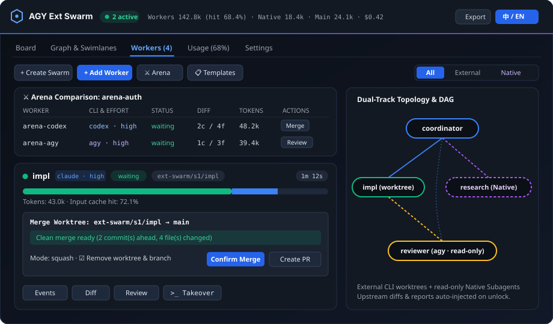

# AGY Ext Swarm — Antigravity 外部多 CLI 协作集群插件

> **[English](./README.md)** | 中文文档

[](https://www.npmjs.com/package/agy-ext-swarm)
[](https://github.com/ycuwq/agy-ext-swarm/actions/workflows/ci.yml)
[](./LICENSE)
[](https://nodejs.org/)

[快速开始](#快速开始) · [核心能力](#核心能力) · [支持的 CLI](#支持的-cli-执行器后端) · [配置说明](#配置说明) · [MCP 工具](#mcp-工具列表共-44-个18-模型工具--26-ui-专用工具) · [开发与打包](#开发与打包)

一个独立开源的 Antigravity（AGY）插件：由 Antigravity 担任 **Coordinator（架构设计 / 任务拆解 / Diff 审查 / 合入把关）**，在共享消息板上并行调度本机多种外部无头编码 CLI 执行器——内置支持 **`dsh`（DeepSeek Harness）**、**Claude Code（`claude`）**、**OpenAI Codex（`codex`）**、**Gemini CLI（`gemini`）**、**Antigravity CLI（`agy`）** 以及**任意自定义 CLI 命令**，并在隔离的 `git worktree` 分支中安全协作交付。



## 快速开始

### 推荐方式：Antigravity 桌面端通过 `npx` 一键安装（跨平台）

只需 **Node.js >= 20**（无需提前安装 `git`、`pnpm` 或 `agy` CLI），自动将零运行时依赖的完整插件复制到 `~/.gemini/config/plugins/agy-ext-swarm`，升级时自动保留 `.data/` 历史数据：

```bash
npx -y agy-ext-swarm install
```

常用管理命令：

```bash
npx -y agy-ext-swarm status               # 查看安装路径、版本与产物健康状态
npx -y agy-ext-swarm install --workspace  # 安装到当前项目 .agents/plugins/（团队共享）
npx -y agy-ext-swarm uninstall            # 卸载全局插件
```

### 备选方式：通过 `agy` CLI 直接安装仓库

```bash
agy plugin install https://github.com/ycuwq/agy-ext-swarm
```

<details>
<summary>更多安装方式（curl / PowerShell / 离线压缩包 / 源码构建）</summary>

- **macOS / Linux（GitHub Release 一键安装）**：
  ```bash
  curl -fsSL https://raw.githubusercontent.com/ycuwq/agy-ext-swarm/main/scripts/install.sh | bash
  ```
- **Windows PowerShell（GitHub Release 一键安装）**：
  ```powershell
  irm https://raw.githubusercontent.com/ycuwq/agy-ext-swarm/main/scripts/install.ps1 | iex
  ```
- **手动离线安装**：从 [GitHub Releases](https://github.com/ycuwq/agy-ext-swarm/releases) 下载 `agy-ext-swarm.tar.gz` 或 `agy-ext-swarm.zip`，将解压后的 `agy-ext-swarm/` 目录放入 `~/.gemini/config/plugins/`（或 `.agents/plugins/`），无需运行 `pnpm install`。
- **从源码安装（贡献者适用）**：
  ```bash
  git clone https://github.com/ycuwq/agy-ext-swarm.git
  cd agy-ext-swarm
  node scripts/install.mjs   # 源码目录默认建软链/junction（--copy 复制独立产物，--build 强制重编）
  ```
  手动构建：
  ```bash
  cd agy-ext-swarm/server && pnpm install && pnpm build
  ```

</details>

### 3 步快速上手

1. 在 Antigravity 桌面端的 **Skills & Customizations** 中启用 **AGY Ext Swarm**（插件升级后开关一次或重启 Antigravity 加载新版服务）。
2. 打开看板或让 Antigravity 调用 `ext_swarm_providers`：首次启动的**引导向导（Onboarding）**会自动探测本机 CLI 与可用模型，一步完成默认后端与读写角色池配置。
3. 直接用自然语言下达并行开发、批量重构、只读调研或交叉审查需求——Antigravity 会自动拉起隔离 worktree 执行器、验收 Diff 并引导一键合入或发起 GitHub PR。

**环境要求**：`Node.js >= 20`、`git`（推荐 `>= 2.38` 以支持 `git merge-tree --write-tree`），以及至少一个 CLI（`dsh`、`claude`、`codex`、`gemini`、`agy` 或自定义命令）。

## 核心能力

### 1. 多 CLI 编排与智能路由
- **免手动配置、AI 自动委派（`rules/AGENTS.md`）**：遇到多模块开发、批量分片、只读调研或交叉审查时，按 `balanced` / `prefer-external` / `manual-only` 策略自动建群调度；日常单文件小改动零打扰。
- **模型自动发现、场景路由与一键预设**：自动探测本地缓存与 CLI 模型列表（含 `agy models` 异步兜底），支持按 `task_type` 分配读写工作池、429 限流冷却自动跳过，并内置 **OpenCode**、**Aider**、**Qwen Code**、**Goose** 一键预设。
- **跨 CLI 推理强度、快速档与真实默认值可观测**：统一支持 `reasoning_effort` 与 `fast_mode`（覆盖派活、路由、模板与卡片控制），并自动记录展示各后端实际生效的默认模型与推理档位。
- **可复用团队编排模板**：内置 `feature-squad`、`bug-hunt`、`doc-and-test`、`review-loop` 模板，自动合并全局及仓库级 `.agy-ext-swarm/templates.json`（支持从当前群一键保存为模板）。

### 2. Worktree 隔离、门禁验收与安全合入
- **Worktree 环境预热与端口隔离**：写手在独立 `git worktree` 分支（`ext-swarm/<swarmId>/<worker>`）工作，配合 `.agy-ext-swarm/worktree.json` 自动完成 `copyFiles`、`symlinkDirs`、`setupCommand`/`teardownCommand` 及 `SWARM_WORKER_INDEX` / `SWARM_PORT_OFFSET` 端口隔离。
- **确定性 DAG（`depends_on`）与自愈重试**：带前置依赖的执行器自动排队为 `blocked`，上游完工后自动注入改动摘要与纯净 Markdown `reportPath` 路径；支持 `allowed_files`（`scope_mode: "enforce" | "warn"`）和 `auto_verify`（可配 `verify_timeout_seconds` 默认 `300s` 及 `max_verify_retries` 自动修复循环）。
- **零副作用冲突预检、合入与直出 PR**：通过 `git merge-tree --write-tree` 预检分支冲突，支持按 `squash`、`cherry-pick` 或 `merge` 安全合入，或一键调用本机 `gh` 推送分支并创建预填测试与审查结果的 GitHub PR。

### 3. 双语实时侧边栏与人机协同
- **中英文 5 页签 MCP App 看板（`中 / EN`）**：涵盖 **消息板**、**拓扑与并行泳道**、**执行器控制台 + 日志/Diff/合入抽屉**、**用量看板** 以及拆分后的 **配置中心**（`CLI 与模型` / `协同与路由`）。
- **Arena 同题竞技与跨厂商交叉审查**：同题拉起 2+ CLI 并行实现并横向对比 Diff/Token（`ext_swarm_arena`），或自动指定另一厂商执行器进行只读复核（`ext_swarm_cross_review`）。
- **行内 Diff 批注打回、原位换模与终端接管**：可在彩色 Diff 抽屉点击代码行直接向 `@worker` 发送定点修改指令；支持原位切换 `provider`/`model`/`reasoning_effort`/`fast_mode`、清空会话重来（`reset_session: true`）或一键复制 **`>_ 接管`** 终端命令。
- **0 轮询后台等待与防卡死看门狗**：`ext-board wait` 基于内核 `fs.watch` 响应唤醒；worker 长汇报自动落盘为 `reports/seq-*.md`；内置回合超时（默认 `1800s` 且保留会话时自动收敛续跑 1 次）与静默看门狗（默认 `300s`）。

### 4. 三元观测、自动计费与复盘导出
- **宿主内置 Subagent 只读观测**：即使尚未启动外部 Swarm，也能自动发现 Antigravity 原生 Subagent，支持来源/波次筛选、只读轨迹抽屉、双轨拓扑连线与**并行泳道（Swimlanes）**时间轴。
- **三元归因与三层自动计费**：统一统计 **AGY 主模型**（兼容 Orchestrator Plan/Execute 多模型拆分）、**内置 Subagents** 与 **外部 CLI 执行器** 的 Token 及缓存命中率；融合 CLI 原生 `total_cost_usd`、内置基准单价与按需联网同步的 **LiteLLM / OpenRouter** 报价目录，支持全局 **CNY / USD** 换算。
- **预算熔断与战报导出**：支持按 Swarm 设定 `max_cost_usd` 费用上限并随时暂停/恢复/上调，随时通过 `ext_swarm_export` 生成完整 Markdown 复盘战报。

## 支持的 CLI 执行器后端

| Provider ID | CLI 命令 | 会话续跑 | 强度 / 快速档 | 流式格式与说明 |
| --- | --- | --- | --- | --- |
| `dsh` | `dsh`（`$DSH_BIN`） | `--session-id` | 推理强度（`low`–`xhigh`） | NDJSON（`--json`），支持读取 `cordis.patch.yml` 并按执行器 `--patch` 指定模型。 |
| `claude` | `claude`（`$CLAUDE_BIN`） | `--resume` | 推理强度（`low`–`max`）+ 快速档 | `stream-json`，自动映射 `plan` / `acceptEdits` / 跳过权限预设。 |
| `codex` | `codex`（`$CODEX_BIN`） | `exec resume` | 推理强度（`low`–`ultra`）+ 快速档 | JSONL（`--json`），调用 `codex exec` / `exec resume` 并传递 `--sandbox`。 |
| `gemini` | `gemini`（`$GEMINI_BIN`） | `--resume` | — | `stream-json`，通过 `gemini -p --output-format stream-json` 执行。 |
| `agy` | `agy`（`$AGY_BIN`） | `--conversation` | 推理强度（`low`–`max`） | 双向 `stream-json`，支持 `--effort` 与显示名档位改写、沙箱只读审查。 |
| `custom` / `<id>` | 任意可执行命令 | 可选 `resumeArgs` | 可通过模板参数配置 | `text` 或 `ndjson`，支持内联 `custom_command` 或 `providers.json` 登记。 |

### 后端使用提醒（`agy` 与 `dsh`）

- **`agy` CLI**：只读审查会自动附加 `--mode plan`、`--sandbox` 与 `--add-dir`（授权访问 `swarmDir` 与 `gitCommonDir`）；当本地模型缓存为空时，`ext_swarm_models` 会自动异步兜底运行 `agy models`。若无头只读命令遭遇权限拦截，请检查 `~/.gemini/antigravity-cli/settings.json`。
- **`dsh` Profile 隔离**：严禁修改 `~/.dsh/profiles/desktop`（由桌面客户端独占锁定）。执行器默认运行于 `headless`（或配置页指定 profile），只读读取同级 profile 目录并通过 `--patch` 透传，不改写磁盘原配置。

## 配置说明

### 自动探测与 `providers.json`

未显式指定 `default_provider` 时，插件按以下顺序选择默认后端：
1. 读取 `<repo_root>/.agy-ext-swarm/providers.json` 或 `${PLUGIN_DATA}/providers.json` 中的 `"defaultProvider"`；
2. 否则按 `dsh` → `claude` → `codex` → `gemini` → `agy` 顺序选用 `PATH` 中首个可用内置 CLI；
3. 再否则选用首个可用自定义 CLI。

`providers.json` 配置示例（含条件参数占位符）：

```json
{
  "defaultProvider": "my-agent",
  "defaultTurnTimeoutSeconds": 1800,
  "defaultStallTimeoutSeconds": 300,
  "providers": {
    "my-agent": {
      "displayName": "我的本地编程 CLI",
      "command": "my-agent-cli",
      "args": [
        "--cwd", "{{cwd}}",
        "{{?model:--model}}", "{{model}}",
        "{{?reasoningEffort:--effort}}", "{{reasoningEffort}}",
        "{{?fastMode:--fast}}", "{{fastMode}}",
        "-p", "{{prompt}}"
      ],
      "resumeArgs": [
        "--cwd", "{{cwd}}",
        "--resume", "{{sessionId}}",
        "{{?model:--model}}", "{{model}}",
        "-p", "{{prompt}}"
      ],
      "listModelsArgs": ["models"],
      "promptMode": "arg",
      "outputFormat": "text",
      "defaultModel": "default",
      "models": ["default", "fast"]
    }
  }
}
```

`args` 与 `resumeArgs` 支持的模板变量：
`{{prompt}}`、`{{model}}`、`{{reasoningEffort}}`、`{{fastMode}}`、`{{cwd}}`、`{{sessionId}}`、`{{permissionMode}}`、`{{workerName}}`、`{{swarmDir}}`、`{{gitCommonDir}}`、`{{boardCli}}`，以及独占参数项的条件占位符（`{{?model:--flag}}`、`{{?model:--flag=}}`、`{{?reasoningEffort:--effort}}`、`{{?fastMode:--fast}}`）。

### Worktree 预热与端口隔离（`.agy-ext-swarm/worktree.json`）

在仓库根目录放置 `.agy-ext-swarm/worktree.json` 可自动预热新 worktree 并通过环境变量隔离并发服务端口（`SWARM_WORKER_INDEX`、`SWARM_PORT_OFFSET`）：

```json
{
  "copyFiles": [".env.local"],
  "symlinkDirs": ["node_modules"],
  "setupCommand": "pnpm db:migrate",
  "teardownCommand": "pnpm db:cleanup",
  "portOffsetBase": 4000,
  "portOffsetStep": 20
}
```

`copyFiles` 与 `symlinkDirs` 中的路径均会校验限制在仓库根目录内，防止路径穿越。

## MCP 工具列表（共 44 个：18 模型工具 + 26 UI 专用工具）

### 模型侧工具（18 个）

| 工具名 | 用途 |
| --- | --- |
| `ext_swarm_providers` | 查看内置/自定义 CLI 状态、`activePool`、`routingPolicy`（`delegationMode`、`taskRouting`、`routingNotes`、读写分工）、限流 `cooldowns`、默认超时与识别出的 `defaultProvider`。 |
| `ext_swarm_models` | 按 `provider` 查询模型（`dsh` `lastCatalog`、`agy` 缓存读取 + 异步 `agy models` 兜底，以及其他后端配置列表）。 |
| `ext_swarm_create` | 创建绑定 `repo_root` 的 Swarm，支持设置 `active_providers`、`routing_policy`、`max_cost_usd` 与 `coordinator_conversation_id`。 |
| `ext_swarm_add` | 启动单个执行器、多 CLI 镜像（`providers`）或 `tasks` 分片池，支持 `task_type`、`reasoning_effort`、`fast_mode`、`workspace`、`allowed_files`、`scope_mode`、`verify_commands`、`auto_verify`、`verify_timeout_seconds`、`max_verify_retries` 与 `depends_on` DAG。 |
| `ext_swarm_post` | 以 `coordinator` 身份发帖并唤醒 `@` 目标（跳过 `blocked` 与 `killed`），返回 `delivery`（`woken` / `deferred` / `skipped`）。 |
| `ext_swarm_read` | 按 `since` 增量读取消息板内容（支持可选 `agent` 发送者过滤）。 |
| `ext_swarm_status` | 查看成员状态、`hostTelemetry`（主模型与内置 Subagents）、越界文件、`lastVerifyResults`、可选 Diff 与 `asyncWaitCommand`。 |
| `ext_swarm_wait` | 在 1–90 秒内等待新消息、`@coordinator`、全部空闲或指定执行器完工（内置 12 KB 自适应 `compactMode` + `reportPath`，可配合 `ext-board wait` 后台等待）。 |
| `ext_swarm_update_worker` | 原位切换 `waiting`/`failed` 执行器的 `provider`/`model`/`reasoning_effort`/`fast_mode`、清空会话（`reset_session: true`）或直接重试续跑，保留原 worktree。 |
| `ext_swarm_merge` | 使用 `git merge-tree` 零副作用预检冲突（`action: "preview"`）、安全合入（`action: "apply"`）或推送并创建 GitHub PR（`action: "pr"`）。 |
| `ext_swarm_arena` | 在隔离 worktree 中并行拉起 2+ CLI / 模型同题竞技并横向对比结果。 |
| `ext_swarm_cross_review` | 自动选择或指定另一厂商 CLI，对目标分支 Diff 与总结执行只读交叉审查。 |
| `ext_swarm_templates` | 查询合并内置与全局/仓库级 `templates.json` 的团队编排模板。 |
| `ext_swarm_apply_template` | 一键实例化 DAG 团队模板（`feature-squad`、`bug-hunt`、`doc-and-test`、`review-loop` 或自定义），支持注入 `{{goal}}` 及按成员覆盖 `provider`/`model`/`reasoning_effort`/`fast_mode`/`allowed_files_overrides`/`verify_commands_overrides`。 |
| `ext_swarm_kill` | 终止指定执行器或 `all`，可选清理临时 worktree 与分支。 |
| `ext_swarm_delete` | 终止残留进程、清理 worktree/分支并彻底删除历史 Swarm 记录。 |
| `ext_swarm_export` | 导出含成员状态、三元 Token/缓存/费用归因、Diff 与完整消息轨迹的 Markdown 战报。 |
| `ext_swarm_open_board` | 打开侧边栏或全局 MCP App 实时看板。 |

<details>
<summary>UI 专用工具列表（26 个）</summary>

`app_get_snapshot`、`app_post_message`、`app_kill_worker`、`app_get_worker_log`、`app_get_native_subagent_log`、`app_get_worker_diff`、`app_retry_worker`、`app_bind_conversation`、`app_set_ui_prefs`、`app_get_provider_config`、`app_save_provider_config`、`app_test_provider`、`app_discover_models`、`app_delete_swarm`、`app_export_swarm`、`app_preview_merge`、`app_merge_worker`、`app_create_worker_pr`、`app_create_swarm`、`app_update_swarm_budget`、`app_add_worker`、`app_start_arena`、`app_cross_review`、`app_get_templates`、`app_save_template`、`app_apply_template`。

</details>

## 隐私与安全边界

- **宿主日志严格只读**：仅以只读方式解析本机 Antigravity `transcript.jsonl` 与 `.system_generated/` 元数据，不修改任何宿主日志；除显式点击同步报价目录外零后台联网请求。
- **环境变量自动脱敏**：在配置页设置或内联传入的 `env` 变量仅存本地用于 UI 管理，模型侧工具输出自动脱敏（`ext_swarm_providers` 仅返回 `envKeys`，内联 `custom_command.env` 值统一遮蔽为 `***`）。
- **本地沙箱与嵌套防套娃守卫**：外部执行器严格按设定的 `read-only` / `workspace-write` / `danger-full-access` 权限在本地运行，且子进程环境中检测到 `EXT_SWARM_AGENT` 或 `DSH_SWARM_AGENT` 时自动拒绝所有变更类编排工具，从机制上杜绝递归套娃。
- 贡献指南与安全披露流程请参阅 [CONTRIBUTING.md](./CONTRIBUTING.md) 与 [SECURITY.md](./SECURITY.md)。

## 开发与打包

### 侧边栏 UI 源码

UI 由 `server/ui/` 下的 `index.html`、`styles.css`、`app.ts`、`i18n.ts`、`model-options-ui.ts` 与各视图模块（`board-view.ts`、`commander.ts`、`workers-view.ts`、`native-workers-section.ts`、`graph-view.ts`、`timeline-view.ts`、`usage-view.ts`、`pricing-view.ts`、`onboarding-view.ts`、`settings-view.ts`）构建为无外链单文件产物（`server/dist/board.html`，严格小于 1 MiB）。

修改后执行重建，并在 **Skills & Customizations** 中关闭再启用 **AGY Ext Swarm**（调试时也可设置 `EXT_SWARM_APP_HTML`）：

```bash
cd server && pnpm typecheck && pnpm build
```

### 测试与发版打包命令

```bash
cd server
pnpm typecheck        # 服务端与 UI 类型检查
pnpm build            # 构建零依赖单文件产物 dist/index.mjs、dist/providers.mjs、dist/host-telemetry.mjs 与 dist/board.html
pnpm test:host        # 宿主对话记录、拓扑关系与内置 Subagent 观测校验
pnpm test:providers   # 离线验证多 Provider、事件解析、脱敏安全与中英文偏好
pnpm test:standalone  # 零依赖独立产物包与 MCP/SSE 冒烟测试
pnpm test:smoke       # 真实 dsh 端到端冒烟测试

# 在仓库根目录校验并生成 GitHub Release 归档包（.tar.gz、.zip 与 SHA256SUMS.txt）
node scripts/package-release.mjs
```

## 开源协议

[MIT](./LICENSE)
